<picture>
  <source media="(prefers-color-scheme: dark)" srcset="assets/hero-dark.svg">
  
</picture>

  <a href="https://github.com/FelipeFeerreira?tab=repositories">repositories</a> ·
  <a href="https://www.linkedin.com/in/fefeerreira">linkedin</a> ·
  <a href="https://www.upwork.com/freelancers/~019235568d9d0f6289">upwork</a>

---

I build the software a small business actually runs on — point of sale, booking,
inventory, storefronts — and the agents that sit around it. São Paulo, Brazil. Remote,
UTC-3.

## What I ship

| | |
| --- | --- |
| **Business systems** | Sales, stock, customer credit and finance. Desktop or web, built for operators who use it all day. |
| **AI that does work** | Tool calling, RAG over a real knowledge base, human escalation, CRM sync. Wired into the workflow, not bolted onto a form. |
| **Agent surfaces** | A store database exposed as a read-only contract (JSON CLI + MCP) so an agent can answer without touching production. |

## Selected work

<table>
<tr>
<td width="50%" valign="top">

### [AgentDesk AI](https://github.com/FelipeFeerreira/agentdesk-ai)

Support and sales platform: tool calling, RAG, CRM sync, escalation, n8n
automations, WhatsApp and web channels, background jobs and observability.
Screenshots are real captures and the demo runs without API keys.

TypeScript · Next.js · PostgreSQL · Prisma · LLM

</td>
<td width="50%" valign="top">

### [Vertice Realty](https://github.com/FelipeFeerreira/vertice-realty) · [demo](https://vertice-realty.vercel.app)

Real estate site with a working concierge, deterministic lead scoring, viewing
requests and an agent CRM. The score is code, not a model guess, so anyone can
explain why a lead is hot.

TypeScript · Next.js · Prisma · PostgreSQL

</td>
</tr>
<tr>
<td width="50%" valign="top">

### [Bloom Wellness](https://github.com/FelipeFeerreira/bloom-wellness) · [demo](https://bloom-wellnessdefinitive.vercel.app)

Clinic booking with real availability, plus what happens after each submission:
confirmation email, owner alert and a CRM entry the team manages from a private
dashboard.

TypeScript · Next.js · Prisma · PostgreSQL

</td>
<td width="50%" valign="top">

### [Rastro Público](https://github.com/FelipeFeerreira/rastro-publico)

Open-source platform for investigating Brazilian public spending. Natural-language
search, municipal and campus dashboards, and a deterministic audit engine that flags
anomalies for human review — never as proof of wrongdoing.

Python · FastAPI · Next.js · PostgreSQL · Docker

</td>
</tr>
</table>

## Engineering with agents

I use agents to write code, and keep the parts that make that safe in the repository.

- **[pos-agent-surface](https://github.com/FelipeFeerreira/pos-agent-surface)** — a
  read-only surface over the store's POS database: four queries (low stock, open credit,
  expiry, day summary) as a JSON CLI, plus an MCP wrapper. The CLI contract is covered by
  tests and CI runs them on Python 3.11 and 3.13.
- **Spec first.** The work starts as `SPEC.md`; the agent implements against it, not against
  a hunch.
- **Tests are the gate.** A change lands when CI is green — the same rule whether I wrote it
  or an agent did.
- **Read-only by default.** Agents get narrow contracts and no credentials in the repository.

## All projects

| Project | What it does | Stack |
| --- | --- | --- |
| [AgentDesk AI](https://github.com/FelipeFeerreira/agentdesk-ai) | AI support and sales platform with RAG, tool calling and CRM sync | TypeScript, Next.js, Prisma |
| [Vertice Realty](https://github.com/FelipeFeerreira/vertice-realty) | Real estate concierge, lead scoring and agent CRM | TypeScript, Next.js, Prisma |
| [Bloom Wellness](https://github.com/FelipeFeerreira/bloom-wellness) | Clinic booking with email, WhatsApp and CRM automations | TypeScript, Next.js, Prisma |
| [Ember & Oak](https://github.com/FelipeFeerreira/ember-oak-coffee) | Coffee storefront with an AI shopping guide and test checkout | TypeScript, Next.js, Stripe |
| [AUREO Fashion](https://github.com/FelipeFeerreira/aureo-fashion) | Fashion e-commerce with variants and a brand panel | TypeScript, Next.js, Prisma |
| [Rastro Público](https://github.com/FelipeFeerreira/rastro-publico) | Public spending search, dashboards and audit engine | Python, FastAPI, Next.js |
| [Retail POS — Java](https://github.com/FelipeFeerreira/retail-pos-java) | Store back office: sales, stock, credit, purchasing, finance | Java, Spring Boot, React, PostgreSQL |
| [Retail POS — Python](https://github.com/FelipeFeerreira/retail-pos-python) | Desktop retail operations with FEFO batches and customer credit | Python, Tkinter, SQLite |
| [pos-agent-surface](https://github.com/FelipeFeerreira/pos-agent-surface) | Read-only agent surface for the POS database (CLI + MCP) | Python, MCP, pytest |
| [Northline Studio](https://github.com/FelipeFeerreira/northline-studio) | Agency site concept with a database-backed contact flow | TypeScript, Next.js, Prisma |
| [Second Brain](https://github.com/FelipeFeerreira/second-brain) | Local-first Markdown notes with backlinks and a knowledge graph | Python, Flask |

Game prototypes, kept as systems studies: [Stylish Combat](https://github.com/FelipeFeerreira/stylish-combat-unity)
and [Justiceiro](https://github.com/FelipeFeerreira/justiceiro-unity) (Unity, C#),
[ElectroCooked](https://github.com/FelipeFeerreira/electrocooked-unity) (educational, Unity),
[Campus Clash](https://github.com/FelipeFeerreira/campus-clash-unreal) (Unreal, C++).

## Stack

TypeScript · Next.js · React · Tailwind · Python · FastAPI · Java · Spring Boot ·
Node · PostgreSQL · Prisma · SQLite · Docker · GitHub Actions · Unity (C#) · Unreal (C++)

## About

Control and Automation Engineering student at IFSP, graduating in 2026. Before and
alongside that: support and development work at a mobility startup, an insurance assistance
company and a supply-planning internship at PepsiCo. Everything above is my own project
work, not client delivery.

I am going deeper on LLM application architecture and backend reliability, and I keep the
games around because a combat prototype and a checkout have the same problem underneath:
state, feedback and failure modes.

  <a href="https://www.upwork.com/freelancers/~019235568d9d0f6289">Need a system, a site or an automation? Let's talk on Upwork.</a>

